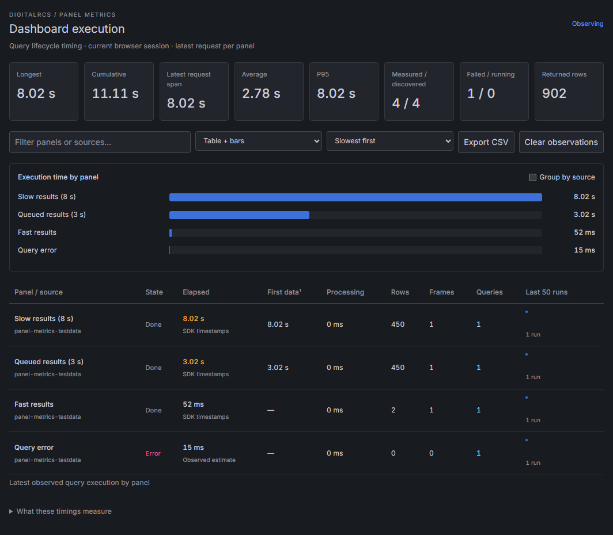

# DigitalRCS Panel Metrics

See which dashboard panels take longest to return data. Panel Metrics displays live query durations, a sortable comparison table, a bar chart, and dashboard timing summaries without issuing additional data-source queries.

## What you can see

- Per-panel elapsed time and Loading, Streaming, Done, Error, Interrupted, or Not observed status.
- A horizontal bar chart comparing panel durations or cumulative duration by source group.
- Longest, cumulative, average, p95, latest-request span, running/error counts, and returned rows.
- First observed data, processing time where supplied by Grafana, frame counts, and query target counts.
- Up to 50 terminal request durations per panel as a session-history sparkline.
- Filtering, slow-query highlighting, and CSV export of the current table.

A query lasting 324 seconds appears as **5.40 m**. Loading and streaming queries keep an elapsed timer until Grafana reports completion or an error. Queue and polling waits are included only when the source keeps the same logical request active.

## Requirements

Grafana 13.1.8 or newer with a Scenes dashboard. Tested on Grafana 13.1.8 and 13.2.4. No external service, credentials, or dedicated data source is required by the metrics panel. Your other dashboard panels use their existing data sources and permissions.

**Compatibility boundary:** dashboard-wide observation uses a read-only internal Grafana Scenes adapter, because the public panel SDK exposes only the current panel's data. Legacy dashboards and frontend-isolated contexts that do not expose the dashboard root are unsupported. The panel displays an unavailable message in these contexts. Future Grafana releases can require adapter updates. Do not change your deployment's security controls to accommodate the plugin.

## Configure your dashboard

1. Choose **Panel Metrics** as a dashboard panel's visualization.
2. Place it where it will remain visible while the panels you want to measure execute.
3. Use Grafana's dashboard Refresh control to start fresh requests. Expand or scroll to lazy-loaded panels when needed; the metrics panel does not activate them.
4. Choose Table, Bars, or Table + bars. Filter by panel title, source identifier, or state; sort by elapsed time or title.
5. Select Group by source for combined source-group bars, or Export CSV for the filtered table.

| Panel option | Default | Purpose |
| --- | --- | --- |
| Default view | Table + bars | Initial presentation; the toolbar can change the current view. |
| Slow query threshold (seconds) | 30 | Highlight elapsed durations at or above this value. |
| Show summary | On | Display aggregate timing and count cards. |

The visualization does not accept an input data-frame schema and does not run its own queries. It reads existing panel metadata. Source labels are Grafana data-source UIDs. A mixed-source panel remains one combined group; the same duration is not attributed to each source separately.

## Read the measurements

| Measurement | Definition |
| --- | --- |
| Elapsed / SDK timestamps | Request end minus request start; a live timer while Loading or Streaming. |
| Observed estimate | Completion was observed without a valid SDK end timestamp. Observation delay can be included. |
| First data | Time to a nonempty response after the collector saw Loading. Unavailable if collection began too late. |
| Processing | Grafana's dataProcessingTime when supplied. This is not visualization paint time. |
| Rows / frames | Latest panel data counts, after transformations when provided by a transformer. |
| Queries | Non-hidden query targets, not HTTP requests. |
| Longest | Largest current panel duration, including live elapsed time. |
| Cumulative | Sum of current panel durations. Overlapping requests are added; this is not dashboard wall time or server CPU usage. |
| Latest request span | Earliest latest-request start to latest end, or now for active requests. Can combine different refresh cycles and include gaps. |
| Average / P95 | Mean / nearest-rank 95th percentile across measured filtered panels, including active requests and errors. |
| Last 50 runs | Terminal durations in completion order, including errors; the x-axis is not wall-clock time. |

Summaries follow the current filter. Unknown values show a dash. Shared-query consumers can count the same underlying query more than once in cumulative totals. **Clear observations** discards current observations/history and ignores earlier requests; it does not refresh data. Use Grafana Refresh afterward for a new measurement window.

## Limits and troubleshooting

- These are query lifecycle measurements, **not final grid/chart rendering times**. Per-source server CPU time, independent queue duration, and Splunk search-job progress are not generically available.
- A datasource that completes a job-submission request and later issues separate polling requests cannot be reconstructed as one job. Splunk-specific integration has not been verified.
- Streaming queries can remain active indefinitely. Cancellation is not consistently exposed; observable provider deactivation is marked Interrupted.
- Not observed can mean lazy loading, no query, cleared observations, or unsupported provider metadata. It does not mean zero milliseconds.
- Keep the metrics panel visible: Grafana can unmount offscreen panels. Navigation, unmounting and reload discard history. SDK timestamps may recover existing request durations, but missed first-data events cannot be recovered.
- Collection is local to this browser session, with limits of 1,000 panels, 10,000 scene nodes, and 50 terminal durations per panel. It does not measure other users, alerting, or server-side rendering.
- For an unavailable message, check the Grafana version and dashboard context. Report the version, screenshot and a sanitized reproducer through the issue tracker.

## Privacy and support

The plugin does not send telemetry, issue data queries, persist observations, or store credentials. It reads existing in-memory panel data references and derives numeric metadata. It does not copy query text, returned field values, or raw error messages into its metrics history. CSV files contain panel titles, source identifiers, statuses and numeric metadata; users control these downloads.

Maintained by DigitalRCS under Apache-2.0. Support is provided through [GitHub issues](https://github.com/digitalrcs/grafana-panel-metrics/issues), not by Grafana Labs. Please sanitize dashboard exports and omit credentials and customer data. See [contribution guidance](https://github.com/digitalrcs/grafana-panel-metrics/blob/main/CONTRIBUTING.md), [security reporting](https://github.com/digitalrcs/grafana-panel-metrics/blob/main/SECURITY.md), and [release readiness](https://github.com/digitalrcs/grafana-panel-metrics/blob/main/docs/PUBLICATION.md).

This project is a public review candidate. A public repository or release does not mean Grafana catalog approval, a public signature, or Grafana Cloud availability.
